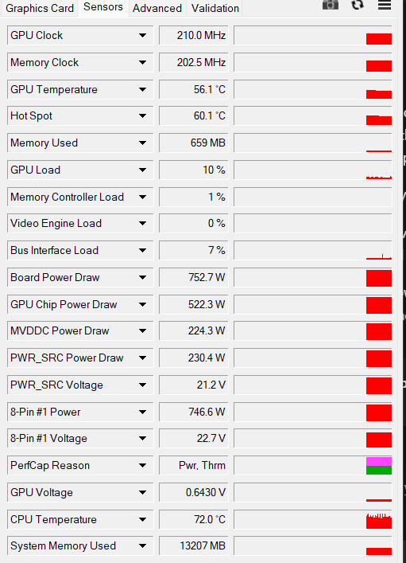
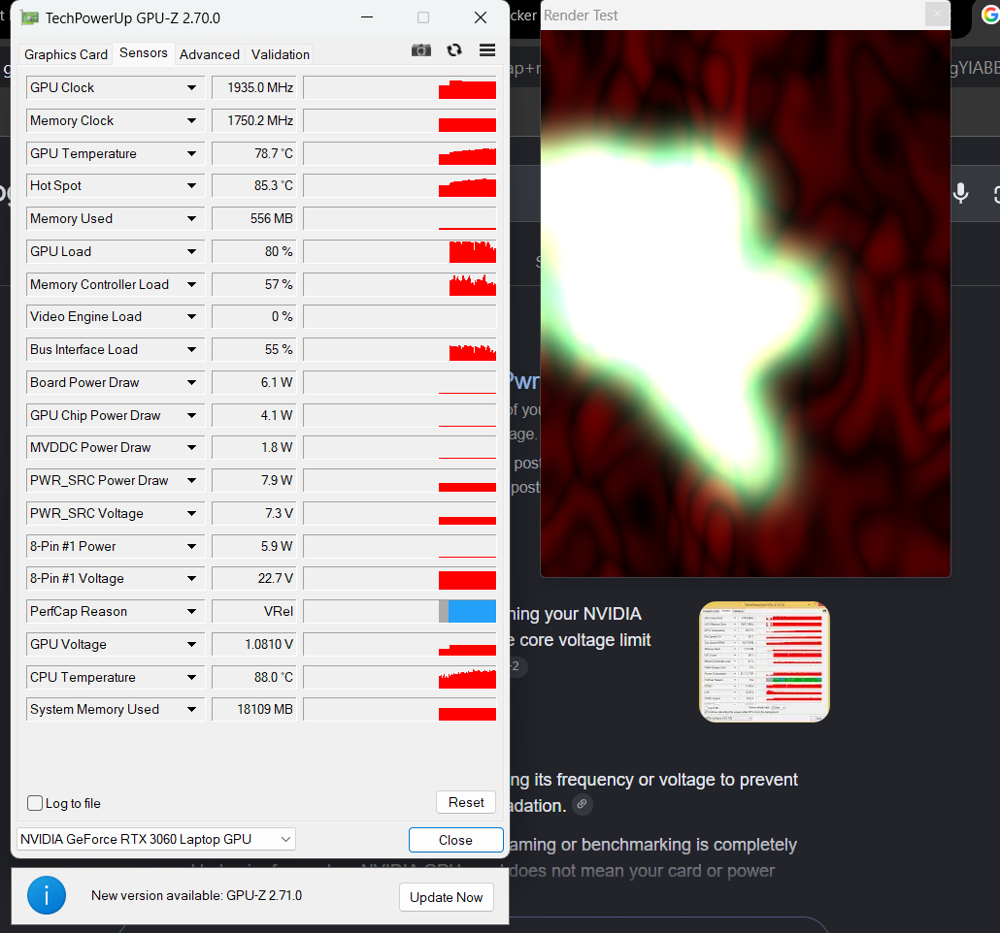

# RTX 3060 laptop: power telemetry and boost investigation

This project documents a Dell G15 5510 RTX 3060 Laptop GPU that reported implausible power readings and remained near 210 MHz on a modern NVIDIA driver. An experimental, **machine-specific** Windows driver override restored boost on the tested laptop. It changes the power/current feedback seen by the driver; the real power draw and the effectiveness of power/current protection have not been independently verified.

**Start here:** [what was tested and what remains unknown](evidence/analysis/slope-override-results-2026-11-11.md). The switch below is not a universal RTX 3060 fix: it contains a specific GPU hardware ID and device instance, and the image is specific to the investigated machine. Do not apply it to another system without establishing compatibility and a recovery path.

## Run the switch on the tested laptop

1. Keep the repository's folders together. In File Explorer open `tools` and double-click [GPU-Slope-Switch.cmd](tools/GPU-Slope-Switch.cmd).
2. Choose **1** for Status, **2** to Enable the override, **3** to Disable it, or **Q** to quit. Status reports the registry configuration and device status; it does not by itself prove which image is loaded or verify protection.
3. For Enable or Disable, save your work first. Type `Enable` or `Disable` when prompted, and approve the administrator prompt. The switch restarts the GPU device and can interrupt graphics applications. Read the result in the administrator window.
4. The enabled override persists until disabled. If a restart fails or the device reports an error, the registry setting may already have changed. Windows restart or Safe Mode may be needed for recovery.

The switch loads [this hash-checked image](evidence/runs/OFFLINE-ONLY-current-slope-relocated-20261110.bin) through a driver registry override; it does **not** flash the VBIOS. Enable and Disable were tested with kernel debugging off. The user also reported that the workaround works with Secure Boot enabled. Version changes and other systems have not been established as compatible.

The displayed 6.1 W and other altered power readings are **not actual measured board power**. The switch cannot independently verify power or current protection. The Afterburner curve and GPU temperature also do not measure total board power.

## Results at a glance

- Before the image override: approximately 210 MHz core with the old manual +1000 MHz offset removed, alongside a fixed, implausible power reading.
- After the override: boost was observed under GPU-Z's render test, including a 1935 MHz core and normal high memory state. These are observed samples, not a guarantee of sustained stability.
- Profile 4 experiments retained a +300 MHz memory offset. The requested 1900 MHz at 825 mV was not demonstrated: a short load capture stayed around 800 mV and 1740–1747 MHz. Some higher-frequency settings crashed or nearly crashed.

## Screenshots

**Before:** GPU-Z reported a fixed, implausible 752.7 W board-power reading and a 210 MHz core clock. This screenshot was taken at low load; other tests recorded the same power reading under load.

**With the override:** the render test showed 1935 MHz core and 1750.2 MHz memory. This is one observation, not a sustained stability result. The 6.1 W and other altered power readings are spoofed, and the screenshot shows a GPU temperature of 78.7 °C.

The [GPU-Z specification screenshot](evidence/screenshots/highlights/03-gpu-specifications.png) records the GPU, driver, VBIOS version, and memory details from the investigation.

## Find your way around

| Location | Purpose |
| --- | --- |
| [tools/](tools/README.md) | The on/off switch, read-only captures, and historical experiment scripts. |
| [evidence/](evidence/README.md) | Results, analysis, raw captures, and the image required by the switch. |
| [Investigation write-up](RTX-Mobile-P8-Lock-Writeup.md) | Historical diagnosis and background; later findings are linked at the top. |
| [Slope override results](evidence/analysis/slope-override-results-2026-11-11.md) | Current observations, limitations, and unresolved questions. |

Some scripts and records are retained as investigation history. A script's presence does not mean it is a supported installer or safe to run on a different GPU. Existing paths are kept in place because the switch and research scripts refer to them.
