# RTX 30-Series Mobile GPU: Permanent P8/210MHz Lock on Newer NVIDIA Drivers

> Update, 11 November 2026: a machine-specific experimental driver-loaded image has restored boost on the tested laptop. It changes power/current feedback and does not establish real board-power protection. See [the slope-override results and limitations](evidence/analysis/slope-override-results-2026-11-11.md) before considering its use.

> Evidence note: some historical explanations below describe the sensor, driver behavior, and clock-floor mechanism more definitively than the tests establish. The exact source and causal path of the invalid reading remain unproven. In particular, the 2026-09-02 IOCTL capture was corrected on 2026-11-07: the input dump was misaddressed and the output buffer changed after the call. See the reverse-engineering section for the current evidence boundary.

## TL;DR

A cross-vendor, cross-OS bug affecting RTX 3000-series (and reportedly newer) mobile GPUs: after updating past a certain NVIDIA driver version, the GPU permanently locks into the lowest performance state (P8, ~210MHz core / ~405MHz memory) and never boosts under load. Monitoring reports wildly incorrect power/current telemetry alongside a software power cap. The source of the invalid value and its causal role in the cap remain unconfirmed. Reverting to an older driver (e.g. 461.92) restores normal boost behavior, at the cost of losing access to newer CUDA versions.

**Update: a working, confirmed software workaround was found for this case** — see "Confirmed Workaround" below. It does not fix the root cause, but it recovers most of the lost performance while staying on a modern driver with full CUDA support.

## Affected Hardware (confirmed across sources)

- Dell G15 5510 (Intel i7-10870H + RTX 3060 Laptop, 6GB) — this case
- MSI laptops (model unspecified in source thread, RTX 3060)
- Acer Nitro 5 (RTX 3060)
- ASUS ROG (model unspecified)
- Medion Erazer Deputy P25 (AMD Ryzen 7 5800H + RTX 3060)

Spans both Intel and AMD CPU platforms, and at least four OEMs, all sharing NVIDIA RTX 30-series mobile GPUs. These reports suggest a common driver or GPU telemetry interaction worth investigating; they do not identify which component causes it.

## Symptom Signature

- Graphics clock frozen at exactly 210MHz (sometimes reported alongside 405MHz or 840MHz memory/video clock, depending on GPU)
- GPU utilization can read 99-100% while clock stays locked — the workload is real, the GPU just won't boost
- Power/current telemetry is internally inconsistent with reality:
  - On working drivers: power reading can freeze at an implausibly low flat value (e.g. 6.1W) while clock and utilization visibly vary — a dead telemetry channel, not a real cap
  - On broken drivers: power reading spikes to 700-800W (physically impossible for these parts), current readings on individual rails freeze at high values (e.g. 22-33A per rail)
  - "Power Limit" flag in monitoring tools (HWInfo/HWMonitor) shows active (1) continuously on broken drivers
  - The Power Limit (%) control in MSI Afterburner is greyed out/unavailable on the affected unit, regardless of driver
- GPU temperature stays low (40-50°C) — this is *not* thermal throttling
- Can appear immediately on driver install, or only after the GPU attempts to transition out of P8 under stress (varies by how far past the breaking driver version you are)
- PCIe link can also degrade (seen dropping to Gen1 2.5GT/s with recoverable link errors in this case)

## Working Explanation: Invalid Power-Telemetry Reading + Permanent SW Power Cap

The driver receives a **frozen, physically impossible ~752.67 W** value (see "Definitive Diagnostic" below). On the affected modern-driver configuration, this coincides with a permanent **SW Power Cap** and a clock floor near 210 MHz. The evidence establishes the invalid value at the NVML/API level and rules out several operating-system-level causes. It does **not** yet identify the exact origin of the value: the current-sense circuit, GPU firmware, EC path, and NVIDIA's internal telemetry transport remain competing explanations. Linux reproduction and persistence across OS, EC-reset, and vBIOS tests make a lower-level hardware or firmware fault plausible, but that is an evidence-supported hypothesis—not a confirmed component-level diagnosis.

Prior tests found no improvement after stopping AWCC or a power-drain reset, and the symptom was also reproduced on Linux. The user confirmed the reset included disconnecting the internal battery. Low observed temperatures make thermal throttling a weaker explanation. A defect in the GPU power telemetry circuit remains a plausible hypothesis, not a confirmed diagnosis.

## Definitive Diagnostic: `nvidia-smi -q -d PERFORMANCE,POWER`

**This should be step one for anyone with this symptom** — one read-only command distinguishes every competing theory. `nvidia-smi.exe` ships with the driver (`C:\Windows\System32`), no admin needed:

```
nvidia-smi -q -d PERFORMANCE,POWER
```

Result on this unit (driver 610.62, GPU idle at the desktop):

```
Performance State                : P0
Clocks Event Reasons
    SW Power Cap                 : Active
    HW Slowdown                  : Not Active
        HW Thermal Slowdown      : Not Active
        HW Power Brake Slowdown  : Not Active
Clocks Event Reasons Counters
    SW Power Capping             : 4,007,672,629 µs (cumulative)
    HW Power Braking             : 0 µs
GPU Power Readings
    Average Power Draw           : 752.67 W
    Instantaneous Power Draw     : 752.67 W
    Current Power Limit          : 80.00 W
    Max Power Limit              : 95.00 W
```

What this one readout proves:

- **The power sensor is frozen at 752.67 W.** Average and instantaneous identical to the hundredth of a watt, at desktop idle, on a GPU whose real ceiling is 95 W. This is the phantom ~750 W reading seen in monitoring tools all along — confirmed in the reported driver telemetry, though its precise role in the controller remains unverified.
- **SW Power Cap: Active — permanently.** The reported cap and invalid telemetry coincide with the clock floor; the internal causal path has not been established.
- **HW Power Brake: lifetime counter of zero.** The reported hardware-brake counter is zero. This does not verify the physical protection circuit or exclude other faults.
- **Performance State: P0.** The GPU was never "stuck in P8" — it sits in P0, power-capped to the clock floor. Every P-state-forcing tool (Profile Inspector overrides, Prefer Maximum Performance) was aimed at a problem that never existed, which is why they all did nothing.
- **Why the +1000 offset delivers exactly ~1207 MHz:** the cap crushes the GPU to the bottom of its V/F curve (~210 MHz); a clock offset shifts the entire curve upward, so the same floor lands at ~1207 MHz. The offset never "unlocked boost" — it raised the floor the cap pins you to. The offset has since been removed; the exact internal clock-control mechanism remains unverified.
- **`nvidia-smi -pl` is mathematically useless here**: the max settable limit can never exceed a frozen 752.67 W reading, regardless of what that limit is set to.

**Correction from later in this session**: an earlier version of this document claimed the platform unconditionally overrides vBIOS-declared power limits (based on the ASUS vBIOS test still showing Dell's 80W/95W enforced). A third vBIOS test (Mechrevo, 115W/140W tables) **disproved this** — after flashing it, `nvidia-smi` showed the power limit genuinely change to 115W/140W, exactly matching Mechrevo's declared values. So the power *limit* value is genuinely vBIOS-influenced after all; the ASUS result was likely an incomplete flash of that specific table section, not evidence of a platform override. What doesn't change, across all three vBIOS (Dell 80/95, ASUS 115/130, Mechrevo 115/140): **the final delivered clock with the +1000 offset is 1207MHz, every time**, regardless of which power limit is active. See "The Math" below for why that specific invariance makes sense despite the power limit itself being real and changeable.

### Historical 1207 MHz result

The observed approximately 1207 MHz clock accompanied a manual +1000 MHz core offset; the offset has since been removed. The numerical relationship to the approximately 210 MHz clock is suggestive, but it does not prove the driver's internal clock mechanism, a P8 state, or a permanent ceiling. Current diagnostics report P0 with the software power-cap reason active. Restoring normal boost on the modern driver remains the goal.

## Historical Experiment: MSI Afterburner Core Clock Offset

**Historical result:** a +1000 MHz offset produced approximately 1207 MHz under the reported workload. The offset is now removed; this was not a demonstration of normal boost or of independent power protection.

### Setup
1. Open MSI Afterburner (already handles GPUs where NVIDIA Control Panel may not be available)
2. Under **Clock → Core (MHz)**, click the numeric field and type **1000**, press Enter
3. Click **Apply**
4. Save as a profile, then in **Settings (gear icon) → General**, enable **"Apply overclocking at system startup"** so it survives reboots — without this, the GPU reverts to the 210MHz lock on every restart

### Notes and limitations
- The **Power Limit (%)** slider is greyed out entirely on this unit — vBIOS-level restriction, unrelated to the P8 bug, could not be adjusted
- The simple Core (MHz) offset field **hard-caps at +1000** — typing a higher value (tried 1400) has no effect, it clamps back to 1000
- Actual delivered clock (1207MHz) is noticeably below this chip's normal stock boost range (~1400-1700MHz depending on TGP configuration) — this is a partial recovery, not a full fix

### Validation performed
- **3DMark Steel Nomad benchmark**: GPU clock held perfectly flat at ~1200MHz for the entire benchmark run (no reverting to 210MHz under real sustained load) — confirms the fix is stable, not just an idle-screen reading
  - Score: 1539 vs. same-hardware average of 1823 (~84%) and best of 2186 (~70%) — roughly a 15-16% performance deficit vs. typical same-model laptops, consistent with running at ~80-85% of this chip's normal boost clock
  - Note the pink "GPU Clock Frequency (MHz)" trace in the monitoring graph below staying perfectly flat for the full run — this is the stability confirmation, not just the final score

  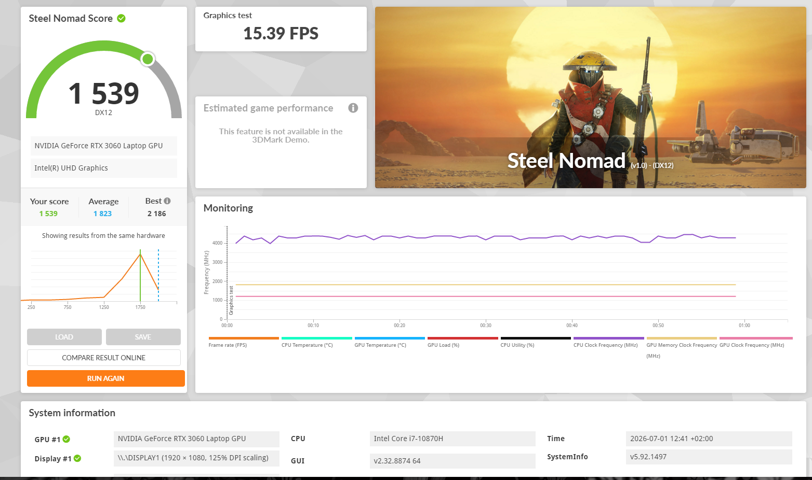
- **eFootball real-world test**: performance was identical or better compared to the original 461.92 baseline. This confirms the original diagnosis (see timeline below) that eFootball's FPS inconsistency was CPU-bound, not GPU-clock-bound — the GPU lock/fix has little to no effect on that specific game either way

## Curve Editor Experiments (attempted, not recommended — documented as negative results)

After the simple offset worked, further attempts were made in Afterburner's Voltage/Frequency Curve Editor to push past 1207MHz toward this chip's normal ~1600-1700MHz boost range. These were **unsuccessful and inconsistent**, and are documented here so nobody repeats the same dead ends:

- The curve editor renders two lines: a **bold/dashed interactive curve** (the actual editable V/F table, confirmed by direct testing — only this one responds to clicks/drags) and a **thin non-interactive reference line** underneath it (does not respond to clicks or drag attempts at all)
- **Attempt 1**: flattened the low-voltage section (700-950mV) of the bold curve to a fixed 2300MHz. Result: **worse** — actual delivered clock dropped to ~1000MHz, lower than the simple offset's 1207MHz
- **Attempt 2**: shifted the entire bold curve uniformly upward by +50MHz. Result: **no change at all** — actual delivered clock remained exactly 1207MHz
- **Conclusion**: actual delivered clock does not scale predictably, linearly, or even monotonically with the configured V/F curve on this unit. The broken telemetry/P-state logic appears to override or ignore the curve in ways that don't respond to straightforward tuning, and can react worse to an artificially flattened curve shape than to the offset-shifted default shape. These were historical experiments; the manual offset has since been removed, and neither the offset nor curve changes established normal boost or verified power protection.

**Follow-up round (later session): locked points can exceed the +1000 slider cap, but it doesn't matter.** Discovered that individually locking a curve point (select a point, press `L`) can hold an offset value above the simple slider's +1000 ceiling — found one persisted at +1050, then manually pushed to +1400 (target ~2607MHz at 731mV). This is genuine new information: the simple offset field's +1000 cap and the curve editor's actual ceiling are two different things. However, every variation tested still produced the identical 1207MHz delivered clock:
- Single-point spike to +1400/2607MHz at 731mV — no change, still 1207MHz
- Full range selected (Shift+click first/last point) and flattened — no change, still 1207MHz
- Entire curve pushed to a 3000+ MHz target — no change, still 1207MHz
- Direct NVML clock lock, bypassing Afterburner and the curve editor entirely (`nvidia-smi -lgc 1350,1702`) — no change, still 1207MHz

These historical curve and VBIOS experiments did not establish the internal clock-control mechanism or rule out other solutions. The measured state on the current driver is P0 with a low clock, not a confirmed P8 lock. Do not infer that editing a VBIOS clock table would correct the power-control problem; no modified firmware was tested as part of this investigation.

## This Case: Full Diagnostic Timeline (Dell G15 5510)

System: Dell G15 5510, i7-10870H, RTX 3060 Laptop 6GB, BIOS 1.38.0 (2025/11), Windows 11 Pro.

1. Baseline complaint: inconsistent FPS in eFootball on driver 461.92, locked to this driver because it's the only one that doesn't force the GPU into permanent P8
2. HWMonitor on 461.92: GPU clock ranges 522-1425MHz normally, utilization moves 14-40%, but GPU Power reads a frozen flat 6.10W throughout — identified as a dead telemetry channel, not a real power cap
3. Installed driver 610 (latest at time of testing): GPU clock frozen at 210MHz, "Power Limit" = 1 constantly, current readings frozen at implausible values, PCIe degraded to Gen1 with 61 recoverable errors
4. Stopped + disabled AWCCService entirely, retested — no change
5. NVCleanstall with only Display Driver + PhysX components — no change
6. A power-drain reset was reported without improvement; the user confirmed the internal battery was disconnected
7. Cross-OS test on Linux with a modern driver — **same lock behavior reproduced**, ruling out Windows/registry/AWCC-stack corruption
8. The fault's source remains unidentified. A GPU power-monitor circuit defect is plausible, but the tests do not establish an EC-to-driver communication fault or identify a failed component. No local shop capable of board-level diagnosis was identified in the historical notes.
9. **MSI Afterburner +1000 Core Clock offset applied on driver 610.62 — GPU recovered to a stable 1207MHz.** Confirmed stable via 3DMark Steel Nomad (clock held flat under full load) and real-world eFootball testing (no regression vs. 461.92 baseline)
10. Further curve editor tuning attempted to push past 1207MHz — inconsistent/regressive results, abandoned in favor of the simple offset (see "Curve Editor Experiments" above)

## Reverse-Engineering Evidence (12–14 July 2026)

The following experiments investigated the route from `nvidia-smi` to the NVIDIA driver. They narrow the search space, but do **not** prove the complete telemetry path or the component that produces `752673 mW`.

### Static observation: NVML exports are runtime-dispatched

Static inspection of the System32 `nvml.dll` export `nvmlDeviceGetPowerUsage` found an indirect thunk shared by many exports. Its statically visible fallback returned `1` (`NVML_ERROR_UNINITIALIZED`). A standalone program nevertheless called `nvmlDeviceGetPowerUsage()` successfully and received `752673 mW`. The most cautious interpretation is that static inspection of the uninitialised dispatch slot is insufficient: runtime binding or an alternate implementation remains possible.

### Controlled direct-NVML capture (2 September 2026)

To replace one-off console output with repeatable evidence, `tools/NvmlEvidenceProbe` dynamically loads NVML and records direct query results without issuing any control operation. Its first ten-second capture on driver `610.62` returned `NVML_SUCCESS` on every sample and recorded `752672` or `752673 mW`, `P0`, `1207 MHz` graphics clock, `7301 MHz` memory clock, and a `115000 mW` enforced limit. The complete CSV, including the two loaded NVML module paths and their SHA-256 hashes, is preserved in [`evidence/runs/nvml-probe-2026-09-02-initial.csv`](evidence/runs/nvml-probe-2026-09-02-initial.csv).

### Direct-NVML dispatch capture (2 September 2026)

The same read-only probe was traced in x64dbg. At runtime, the `C:\\Windows\\System32\\nvml.dll` `nvmlDeviceGetPowerUsage` export was an indirect-jump facade. One step through that jump entered the real named handler in the NVIDIA DriverStore `nvml.dll` instance. This is a direct observation that, for this process, the System32 facade delegates to the DriverStore implementation; it is not evidence of two competing query implementations. The absolute addresses shown in the screenshots are ASLR-dependent and must not be reused as fixed breakpoints.

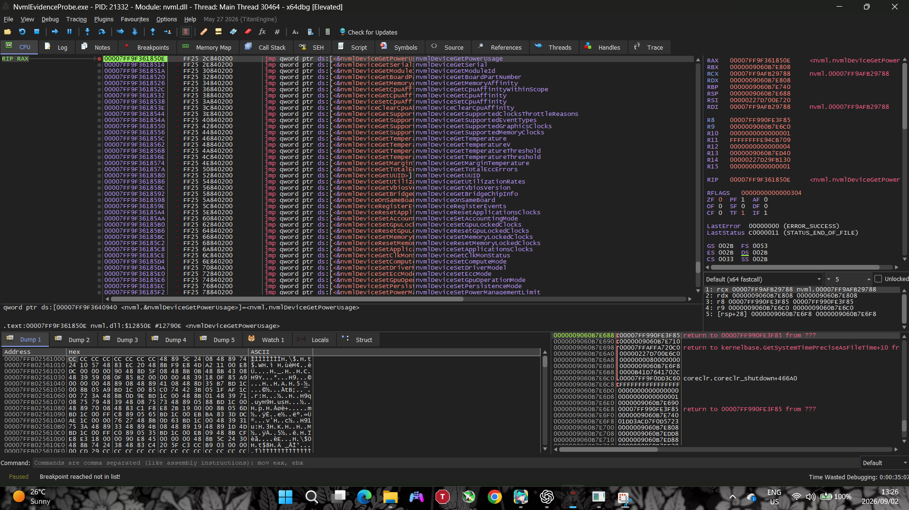

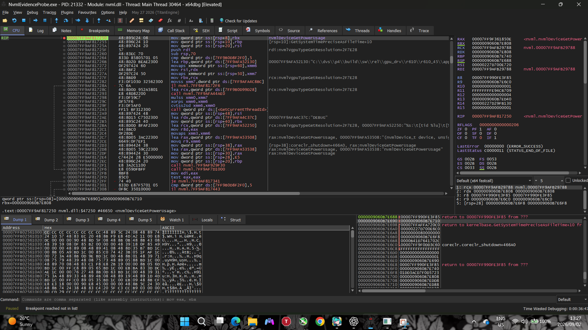

The screenshot manifest and limits of this conclusion are recorded in [`evidence/screenshots/2026-09-02-x64dbg-direct-nvml/README.md`](evidence/screenshots/2026-09-02-x64dbg-direct-nvml/README.md). The proprietary driver binaries themselves are identified by path and SHA-256 in the probe evidence, but are intentionally not copied into this repository.

### Static lead inventory of the captured DriverStore build

A read-only inventory of the exact hash-recorded DriverStore `nvml.dll` found D3DKMT references and a normal static import of `KERNEL32!DeviceIoControl`. A conservative scan found 25 direct call sites to that import across the DLL; this identifies candidates but not a path from the power-usage handler. `D3DKMTEscape` is present as a string but not as a normal static import. The isolated one-call probe again returned `752673 mW`, with no extra clock, P-state, or limit queries. These are focused transport leads, not proof that the power-usage handler calls either route. The target identity, method, results, and limits are preserved in [`evidence/analysis/nvml-driverstore-static-inventory-2026-09-02.md`](evidence/analysis/nvml-driverstore-static-inventory-2026-09-02.md).

The captured power-usage handler is bounded by PE exception metadata to RVA `0x47250–0x474BF`. A deliberately limited static map found internal calls and `GetCurrentThreadId`, but no recognized direct `DeviceIoControl` call across eight map levels. This narrows, but does not settle, the transport question because dynamic and nonstandard call paths are outside that mapper's scope. The complete artifact is [`evidence/analysis/nvml-power-usage-call-map-2026-09-02.txt`](evidence/analysis/nvml-power-usage-call-map-2026-09-02.txt).

### Controlled transport result: DeviceIoControl confirmed

The purpose-built `NvmlPowerOnlyEvidenceProbe` then performed only one device lookup and one direct power-usage query under x64dbg. The DriverStore `nvmlDeviceGetPowerUsage` breakpoint fired first. With `kernel32!DeviceIoControl` armed at that point, continuing stopped at `DeviceIoControl`. Its main-thread stack reads `kernel32!DeviceIoControl` → five internal `nvmlVgpuTypeGetResolution` frames → `nvmlDeviceGetPowerUsage+0x268`. This promotes the normal `DeviceIoControl` route from a DLL-wide candidate to a **confirmed user-mode transport used by this direct power query**.

A fresh post-analysis baseline repeated the deliberately one-query probe at `2026-09-02T13:17:38Z`: it returned `752673 mW` on GPU 0 under driver `610.62` / NVML `13.610.62`, with no P-state, clock, or power-limit call requested. The CSV records the exact loaded System32 facade and DriverStore implementation hashes: [`evidence/runs/nvml-power-only-baseline-2026-09-02-post-static.csv`](evidence/runs/nvml-power-only-baseline-2026-09-02-post-static.csv).

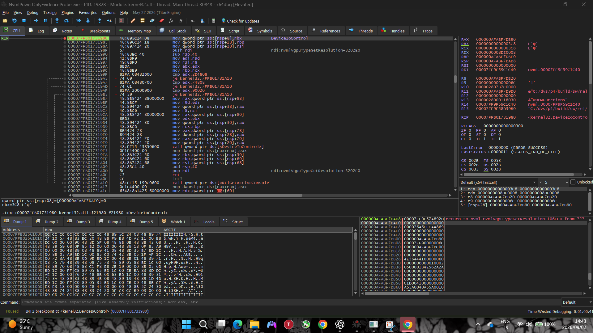

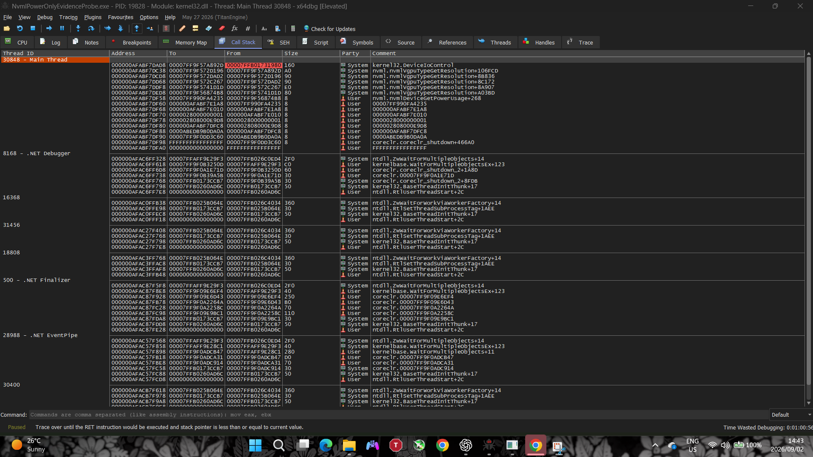

The repeat capture distinguishes a successful `0x08DE0004` preliminary request from the final `0x08DE0008` request that returns through `nvmlDeviceGetPowerUsage+0x268`. At the final boundary, `R8` points to a `0x6C`-byte input and the fifth x64 argument is a distinct output-buffer pointer. Running only to the API return produced `RAX = 1`. Its standard `CTL_CODE` fields mechanically decode to device type `0x08DE`, function `0x002`, `METHOD_BUFFERED`, and `FILE_ANY_ACCESS`; that decoding does not assign NVIDIA-specific semantics. A later screenshot review corrected two errors: the input dump was at the wrong address, and the output bytes did visibly change. The screenshots also suggest a 108-byte output buffer and a returned byte count of 1; these details need fresh confirmation and do not identify the result field. See [`evidence/analysis/nvml-power-query-final-ioctl-2026-09-02.md`](evidence/analysis/nvml-power-query-final-ioctl-2026-09-02.md).

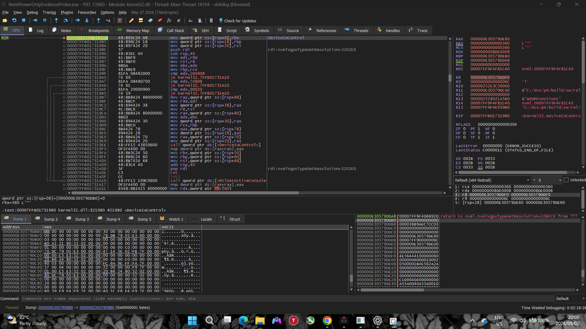

The global breakpoint also observed unrelated initialization and cryptography traffic. A condition on `RDX == 0x08DE0008` isolated the final power-linked request without changing target-process state. The proprietary request payload and lower driver handling remain undecoded; the apparent one-byte return count warrants a repeat capture.

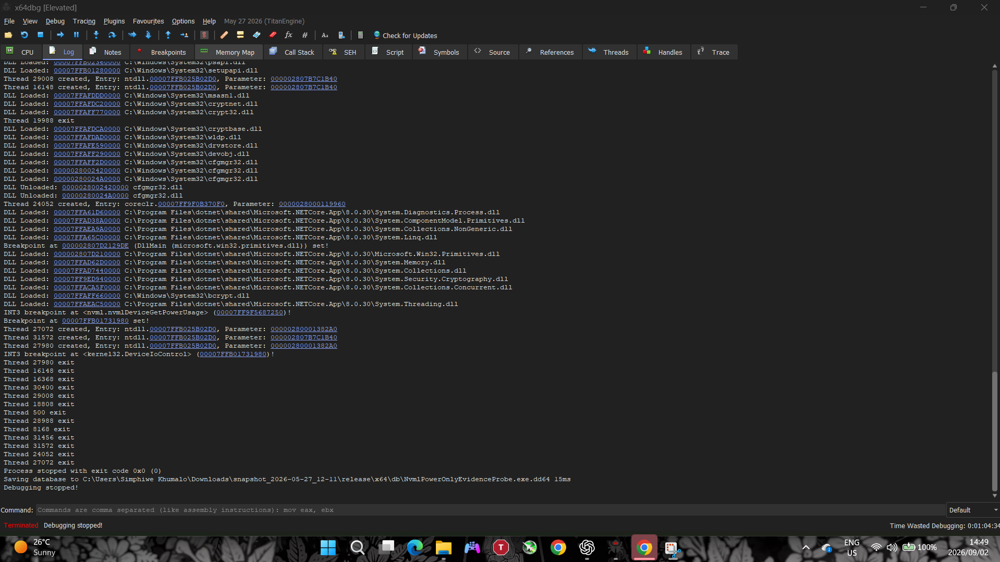

### IOCTL target: `\\.\NvAdminDevice`

The dynamic return address maps to a DriverStore `nvml.dll` function which calls `DeviceIoControl` and then closes handles. Static analysis identified `\\.\NvAdminDevice` as its helper's device path. On 7 November, a new live trace observed `CreateFileA` opening that path on the power-query stack and matched the returned handle `0x374` to the `0x08DE0008` call. That request succeeded and reported 108 returned bytes in this run. This closes the device-handle gap for that run, but neither identifies the physical source nor establishes how power capping works. The observations and their transcription limits are in [`evidence/analysis/nvml-live-handle-2026-11-07.md`](evidence/analysis/nvml-live-handle-2026-11-07.md); earlier static evidence is in [`evidence/analysis/nvml-deviceiocontrol-target-candidates-2026-09-02.md`](evidence/analysis/nvml-deviceiocontrol-target-candidates-2026-09-02.md).

### Dynamic tracing: two NVML module copies load

`nvidia-smi -q -d POWER` was launched under x64dbg. The trace shows a System32 `nvml.dll` load and then a second copy from the NVIDIA DriverStore. The debugger reported that the code bytes did not match when applying the first module's relative offset to the second copy, so they must be treated as distinct module instances during tracing.

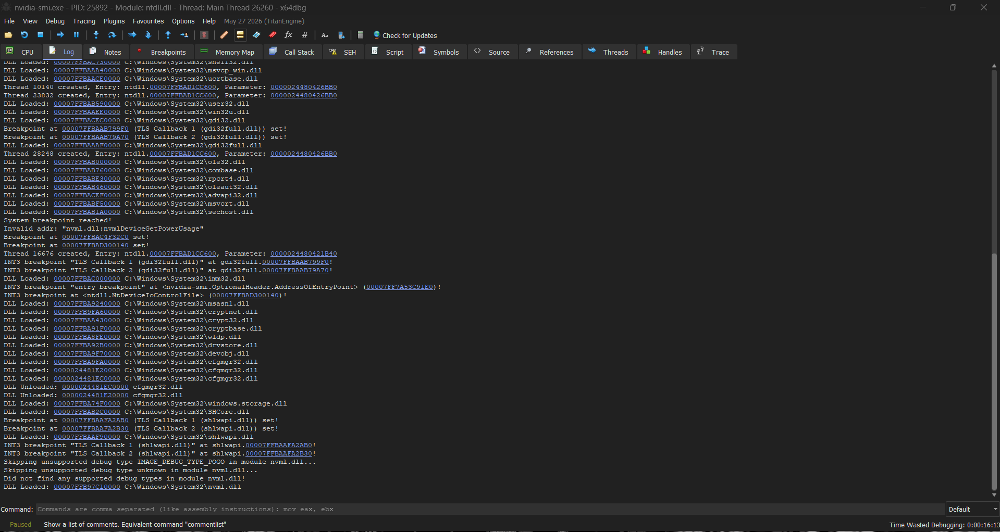

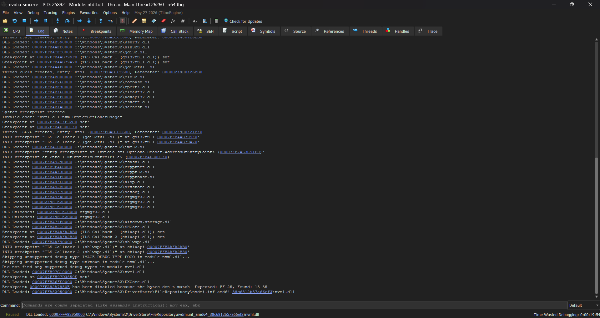

### `nvidia-smi` DeviceIoControl result: observed calls were enumeration, not telemetry

Breakpoints on `kernel32!DeviceIoControl` and `ntdll!NtDeviceIoControlFile` fired during the run. The captured call stack places one observed `DeviceIoControl` call under `cfgmgr32!CM_Get_Device_Interface_PropertyW`, consistent with device enumeration rather than a power query. The full traced command completed successfully.

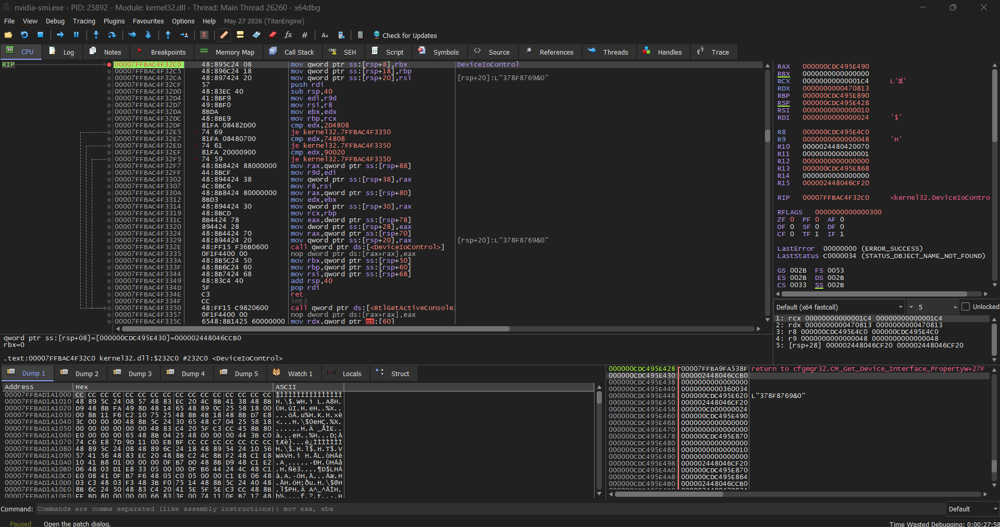

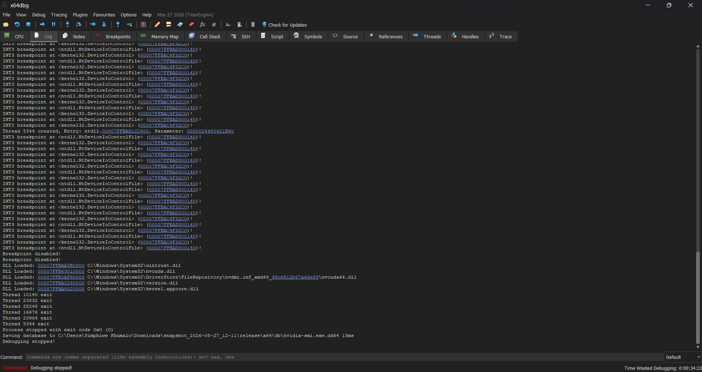

The earlier `nvidia-smi` trace stopped only at device-enumeration-related `DeviceIoControl` calls and did not reveal the power-query transport in that run. The later isolated direct-NVML trace did confirm a `DeviceIoControl` call beneath `nvmlDeviceGetPowerUsage`; it still does **not** identify the kernel driver's payload schema or physical telemetry source.

### ProcMon capture setup

ProcMon was filtered to `nvidia-smi.exe` while testing for `DeviceIoControl` activity. This is retained as reproducibility evidence for the capture configuration; absence of a suitable event in ProcMon is not, by itself, proof that no lower-level transport exists.

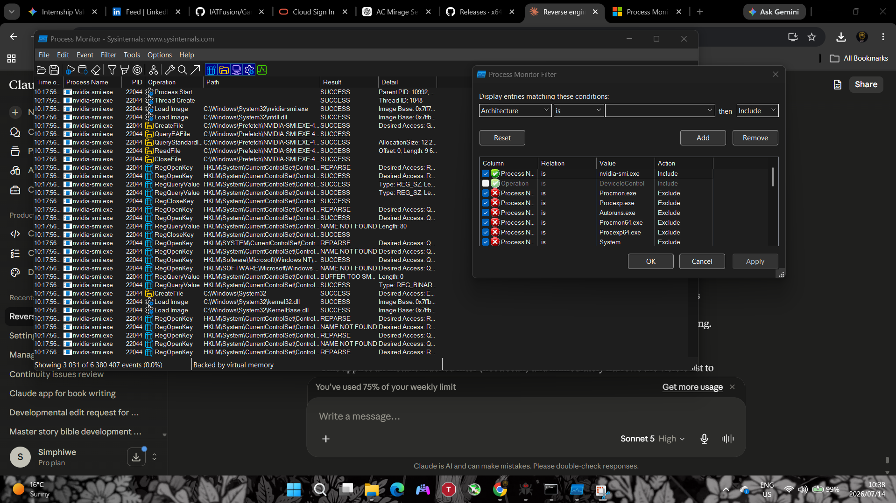

### Current position

On 7 November a read-only scan of a fresh NVML process found a live 4 KiB region whose power-limit, temperature, average-power and instantaneous-power fields match the ordering and values expected from NVIDIA's RUSD monitoring layout. Its two power fields continued updating with the invalid reading. This identifies a strong **monitoring-page candidate**, not the producer or power-controller input; see the [RUSD candidate analysis](evidence/analysis/nvml-rusd-candidate-2026-11-07.md).

| Statement | Status |
|---|---|
| `nvmlDeviceGetPowerUsage()` returned `752673 mW` in a standalone test | Confirmed observation |
| `nvidia-smi` loaded separate System32 and DriverStore NVML modules in the trace | Confirmed observation |
| The System32 `nvmlDeviceGetPowerUsage` facade dispatches into the DriverStore implementation | Confirmed observation in the direct-NVML trace |
| Isolated `nvmlDeviceGetPowerUsage` reaches `kernel32!DeviceIoControl` through DriverStore NVML | Confirmed observation in the power-only trace |
| Observed IOCTL code and input-buffer length for that call | Confirmed observation: `0x08DE0008`, `0x6C` |
| The DriverStore handler's kernel transport and the physical source of the mW value | Unknown |
| `nvidia-smi`-trace `DeviceIoControl` calls were device-enumeration related | Confirmed for that earlier trace only |
| Direct `nvmlDeviceGetPowerUsage` reaches `DeviceIoControl` | Confirmed in the later isolated power-only trace |
| The faulty value originates in a specific sensor, EC, PMU, or firmware component | Unknown |

The next useful reverse-engineering milestone is to validate the live device handle and collect read-only evidence for the IOCTL payload/result schema, then determine which kernel interface ultimately supplies the mW value.

## Ruled Out

| Cause | Status | How it was ruled out |
|---|---|---|
| AWCC / Alienware Command Center | Ruled out | Service stopped + disabled, issue persisted |
| Windows install corruption | Ruled out | Reproduced identically on Linux |
| Stuck volatile EC state | Not established | A power-drain reset that included disconnecting the internal battery was reported without improvement; exact timing and all other steps are not recorded. |
| Thermal throttling | Not indicated in the recorded samples | GPU temperature was low and NVIDIA's thermal-slowdown flags were inactive in the captured samples. This does not verify every temperature sensor or protection. |
| Specific AWCC version (5.x vs older) | Untested | No older AWCC installer available to test |
| BIOS version | Partially ruled out | Already on latest (1.38.0); Dell blocks downgrades on many G-series models |
| Manual V/F curve tuning beyond +1000 offset | Ruled out as unproductive | Flattening gave worse results; uniform shift gave no change (see Curve Editor Experiments) |
| NVIDIA Profile Inspector (P-State override at driver profile level) | Ruled out | Tried previously (prior to this write-up); did not resolve the lock |
| MSI Afterburner OC Scanner | Ruled out | Fails immediately with "Failed to start scanning!" — most likely because OC Scanner requires trustworthy real-time power/voltage telemetry to iteratively test points, which this unit cannot provide (consistent with the root cause) |
| NVIDIA Profile Inspector — "Power Management - Mode" → "Prefer maximum performance" (retested this session) | Ruled out | Set on Global Driver Profile, driver 610.62, Apply Changes clicked. No change to actual GPU clock. Same driver-level-policy-can't-fix-hardware-telemetry pattern as everything else |
| Core (mV) voltage slider in Afterburner | Ruled out | Voltage control is locked/greyed out on this unit, same as the Power Limit (%) slider. Not accessible to test at all |
| **Different vBIOS with a higher-rated power/clock table** (tested 3x: MSI/prior-session, ASUS, Mechrevo) | **Ruled out for delivered clock; power limit itself IS vBIOS-real** | Flashed hash-verified ASUS (94.06.17.00.65, 115W/130W, 1702MHz rated) and Mechrevo (94.06.3B.00.0B, 115W/140W, 1702MHz rated) vBIOS via NVFlash `-6`. Confirmed via `nvidia-smi` that Mechrevo's power limit genuinely took effect (115W/140W exactly, correcting an earlier session note that assumed platform override). Despite the power limit being real and different across all three vBIOS, delivered clock with +1000 offset was **identical: 1207MHz in all three cases** — see "The Math" section for why |
| Locked curve point exceeding the +1000 slider cap (+1050, then +1400) | Ruled out for delivered clock, but genuine new mechanism found | Slider caps at +1000; a locked individual point can hold higher values. Tested as a spike (+1400/2607MHz @ 731mV), a flattened full-range selection, an extreme 3000+ MHz target, and a direct NVML clock lock bypassing Afterburner entirely (`nvidia-smi -lgc`). All four produced identical 1207MHz |
| Editing a VBIOS clock value | Not attempted | The observed 210 MHz occurs with P0 reported; the relevant clock-control mechanism and whether editing a particular firmware table would help are unverified. Firmware modification carries recovery risk. |
| DisableDynamicPstate / KBOOST registry tricks | Ruled out | KBOOST itself hasn't worked on any driver since 378.49 (2017); its "modern equivalent" is the same DisableDynamicPstate key, already tested with no effect |
| GPU power telemetry spoofing | Not attempted | The control-path input and a trustworthy replacement remain unidentified. Modifying monitoring output alone would not establish that boost control changed, and an arbitrary replacement could undermine power protection. |

## Untested — Worth Trying Next

**Update: as of this session, every item below has now been tried or confirmed inaccessible. This section is kept for historical reference — see the Ruled Out table above and the Final Conclusion below for the current state.**

1. ~~NVIDIA Profile Inspector~~ — already tried prior to this write-up, did not resolve the lock. Ruled out (see table above).
2. ~~MSI Afterburner's OC Scanner~~ — fails immediately with "Failed to start scanning!". Ruled out (see table above).
3. ~~The dedicated Core (mV) voltage slider~~ — locked/greyed out on this unit, same as Power Limit (%). Ruled out (see table above).
4. ~~Test the same +1000 offset trick on a vBIOS with genuinely different/higher-rated power and clock tables~~ — completed this session with a hash-verified ASUS vBIOS (94.06.17.00.65, 115W/130W power, 1702MHz rated boost vs Dell's 80W/95W, 1425MHz). Confirmed via GPU-Z that the flash took. **Delivered clock was identical: 1207MHz.** This is the definitive test — see Ruled Out table above.
5. ~~NVIDIA Control Panel → Prefer Maximum Performance~~ — equivalent setting tested via Profile Inspector's "Power Management - Mode", no effect. Ruled out (see table above).
6. **A battery-disconnected reset did not resolve the problem.** The user confirmed that the internal battery was disconnected during the earlier reset. Other details and timing are not recorded; neither this nor a VBIOS swap establishes that every embedded-controller state was cleared.
7. ~~Toggle Hybrid vs. Discrete-only GPU mode in BIOS~~ — **impossible on this unit**: the Dell G15 5510 has no MUX switch, so it's permanently in Hybrid/Optimus mode with no discrete-only option to toggle to. Ruled out, not just untested.
8. ~~Disable the wired Ethernet adapter~~ — **not applicable on this unit**: Device Manager shows no physical wired Ethernet adapter at all (only Wi-Fi, Bluetooth, and virtual/WAN Miniport entries). This specific G15 5510 configuration has no Ethernet port/controller to disable.
9. **VBIOS experiments:** several images were tried and did not restore normal clocks. File hashes and reported versions do not establish the original backup's provenance, the current firmware's full identity, or compatibility of every image with the installed power monitor. These experiments are not a basis for further flashing without a confirmed board-matched recovery path.

## Current Investigation Status

The modern driver currently reports approximately 752.67 W and an active software power cap while the GPU sits around 210 MHz. During a battery test the entire laptop reported approximately 55–62 W of discharge while the GPU still reported 752.67 W, providing a separate system-level cross-check that the GPU reading is implausible. The source of the invalid reading, its exact causal path to boost control, and the physical protection state remain unproven. See [the battery comparison](evidence/analysis/battery-vs-gpu-power-2026-11-07.md) and [kernel investigation](evidence/analysis/kernel-rusd-power-producer-2026-11-07.md).

The historical `DisableDynamicPstate` test did not change the reading. A later temporary Windows NVIDIA platform-controller disable also did not change it immediately; the device was restored. Neither result excludes every firmware or driver-initialization path. As of the latest check, `DisableDynamicPstate` is absent from the queried NVIDIA service and device-class keys. The current VBIOS reports `94.06.3b.00.0b`; the origin or restoration suitability of `backup.rom` has not been independently established.

The +1000 MHz offset was removed at the user's direction. No offset, firmware flash, telemetry override, or claim of normal boost is recommended on the basis of the historical 1207 MHz observation. The objective is to find a viable correction, preserve or independently verify protections, and demonstrate sustained normal boost on a modern driver.


### Further historical tests

Prior tests reported approximately 1207 MHz with the +1000 MHz offset after different VBIOS swaps and curve adjustments. Those observations do not establish an immutable limit or identify the power controller's input. The offset is no longer applied. The current investigation includes telemetry-path analysis and a temporary platform-controller test; results and limitations are recorded under `evidence/analysis`.

A previously reported 461.92 configuration boosted normally, but it did not meet the modern-driver objective. Vulkan on an older driver may be a separate compatibility fallback; it has not been verified as a solution to the current goal.

## Sources

- [MSI Global English Forum — "GPU stuck at 210 MHz"](https://forum-en.msi.com/index.php?threads/gpu-stuck-at-210-mhz.388801/)
- [Tom's Hardware — "GPU on 100% but GPU stuck on 210 mhz"](https://forums.tomshardware.com/threads/gpu-on-100-but-gpu-stuck-on-210-mhz.3803947/)
- [Tom's Hardware — "GPU clock stuck at 210 MHz"](https://forums.tomshardware.com/threads/gpu-clock-stuck-at-210-mhz.3777250/)
- [Tom's Hardware — "My laptop's RTX 3060 is stuck on 210MHz core speed?"](https://forums.tomshardware.com/threads/my-laptops-rtx-3060-is-stuck-on-210mhz-core-speed.3800963/)
- [NVIDIA GeForce Forums — "(LAPTOP) gpu stuck at 210 mhz core clock and 405 mhz"](https://www.nvidia.com/en-us/geforce/forums/geforce-laptops/6/497370/laptop-gpu-stuck-at-210-mhz-core-clock-and-405-mhz/)
- [NVIDIA GeForce Forums — "Laptop GPU stuck at 210 mhz core clock and 405 mhz" (game-ready-drivers board)](https://www.nvidia.com/en-us/geforce/forums/game-ready-drivers/13/511232/laptop-gpu-stuck-at-210-mhz-core-clock-and-405-mhz/)
- [Medion Community — "RTX 3060 stuck at 210 MHz GPU clock on Medion Erazer Deputy P25"](https://community.medion.com/t5/Notebook-Netbook/RTX-3060-stuck-at-210-MHz-GPU-clock-on-Medion-Erazer-Deputy-P25/td-p/185705)
- [ASUS ROG Forum — "GPU clock speed stuck at 210mhz After Re-Install Windows"](https://rog-forum.asus.com/t5/gaming-notebooks/gpu-clock-speed-stuck-at-210mhz-after-re-install-windows-rog/td-p/1124779)
- [Linus Tech Tips — "Gpu clock and watt is getting stuck at 210mhz and 22W"](https://linustechtips.com/topic/1501430-gpu-clock-and-watt-is-getting-stuck-at-210mhz-and-22w-and-not-using-full-power-but-running-at-99-utilization/)
